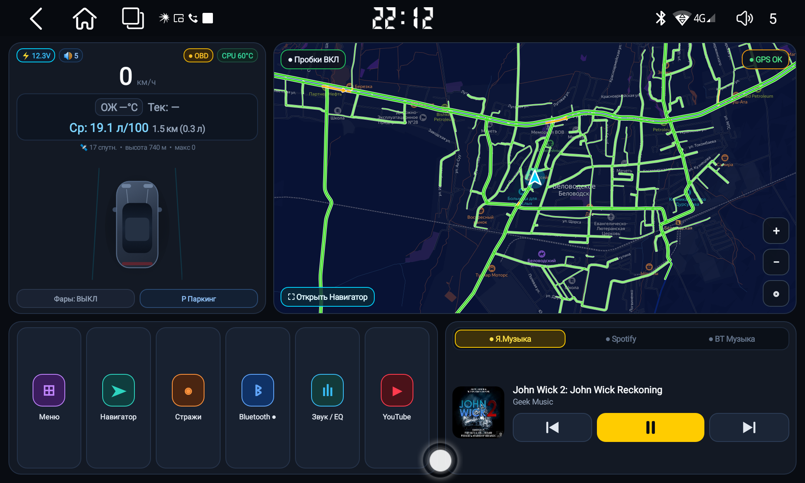

<div align="center">

# 🚗 KC97 Cockpit Launcher

**Ultra-lightweight dark automotive launcher for Android head units (KTE / KC97 / MT6797 / Android 8.0+)**  
*Native Canvas Map & Live Traffic (0 MB WebView) • Direct Blue ELM327 v1.5 OBD-II Fuel Computer (`goc_spp`) • Auto-Night Headlights • 3-Tab Media Widget*

[](CHANGELOG.md)
[-34D399?style=for-the-badge)](#requirements--build-from-source)
[](KC97-Cockpit-Launcher.apk)
[-8B5CF6?style=for-the-badge)](docs/ARCHITECTURE.en.md)
[](LICENSE)

**🇬🇧 English** | **[🇷🇺 Русский](README.ru.md)**

<br/>



</div>

---

## Why KC97 Cockpit?

Many aftermarket Chinese Android head units (e.g., **KC97 / KTE / Helio X20 MT6797** running Android 8.0) ship with bloated stock launchers or heavy 3D/WebView launchers that burn 50–130% CPU, eat 500 MB–1 GB of RAM, and overheat the SoC. Moreover, their stripped Bluetooth stack (`SD-968` chip) often prevents standard apps from seeing cheap blue **Bluetooth ELM327 v1.5** OBD-II adapters.

**KC97 Cockpit** solves all of this in a single **~58 KB** pure-Java APK with **zero external dependencies** and **zero WebViews**:
- **~0% idle CPU**, **~28–36 MB RAM** total footprint.
- Native Canvas dark map + live traffic + persistent offline disk cache.
- Built-in non-root **ELM327 v1.5** driver over `/dev/socket/goc_spp` + transparent **TCP bridge (`127.0.0.1:35000`)** for Car Scanner ELM OBD2.

---

## Key Features (v2.0)

### 0. New in v2.0 — Autonomous Routing, Safe City Cameras & Telemetry Black Box
- **Point B Routing on Main Map (`🏁 Маршрут`):**
  - Search addresses, pick saved **🏠 Home / 💼 Work**, choose built-in **offline Chuy & Issyk-Kul cities**, or **long-press anywhere on the map** to set Point B.
  - Draws a glowing neon route polyline + live remaining `km` and `ETA` directly on the native dark map, with 1-tap handoff to **Yandex Navigator** (`yandexnavi://build_route_on_map`).
  - **Boom Gorge Offline Resilience:** Active OSRM routes are persisted on disk (`/sdcard/KC97MapCache/active_route.txt`), and if 4G drops completely, an offline Chuy–Boom–Issyk-Kul highway corridor router builds the route anyway.
- **Safe City Speed Cameras (`📷 Камеры` — Offline + 1-Tap GitHub Sync):**
  - Bundled offline Kyrgyzstan database (`cameras/speedcam_kg.txt`, standard SpeedCamOnLine/Navitel format) drawn right on the map.
  - Direction-aware **420 m lookahead** (ignores opposite-lane cameras) with configurable alert margin (default **`+9 km/h`** → warns at `69 km/h` in a `60` zone, before KG's `71 km/h` fine).
  - Calm visual banner under the limit; bold **red alert + Russian voice / chime with music ducking** when speeding.
  - **1-tap Update from GitHub** + **1-tap `+ Camera` at current GPS** + drop-in custom `speedcam_custom.txt` support.
- **On-Device Offline Map Sync (Chuy + Boom Gorge + Issyk-Kul):**
  - Download missing offline map tiles (including high-detail `z=14` **Boom Gorge**) straight on the head unit over Wi-Fi — no PC required!
- **Silent Background Trip Telemetry Logger (CSV Black Box):**
  - Invisibly records 1 Hz CSV telemetry (`lat, lon, GPS/ECU speed, RPM, coolant °C, battery V, fuel rates, headlights, handbrake, CPU °C`) to `/sdcard/KC97Logs/` (auto-cleans after 30 days).
  - **1-tap Export** in the OBD menu copies logs to `/sdcard/Download/KC97Logs/` and opens the Android Share sheet (Telegram / WhatsApp / Mail / USB).

### 1. Vehicle Telemetry & OBD-II Fuel Computer
- **Anti-Drift GPS + ECU Speedometer:**
  - When OBD is connected, fuses GPS speed with real ECU wheel speed (`010D`) and RPM (`010C`) — rock-solid `0 km/h` and `P Паркинг` at red lights and while parked.
  - When ignition is OFF (`ACC`), applies smart GPS stationary hysteresis (`6–10 km/h` threshold) so parked GPS jitter never causes phantom `3–5 km/h` jumps.
- **4-Stage Color-Coded Coolant Temperature (`ОЖ` / `0105`):**
  - 🔵 **Blue (`< 50°C`)** — cold engine, warm up / drive gently.
  - 🟢 **Green (`50–98°C`)** — normal operating temperature.
  - 🟡 **Yellow (`99–106°C`)** — elevated temperature, keep an eye on it.
  - 🔴 **Red (`≥ 107°C`)** — overheating warning!
- **Speed-Density Fuel Consumption (Works WITHOUT a MAF Sensor!):**
  - Calibrated for **Honda Stream RN3 (K20A 2.0L i-VTEC, `VE = 0.78`)**, selectable engine displacement `1.5L – 3.5L` right from the dashboard.
  - Uses `MAP (010B)` + `RPM (010C)` + `IAT (010F)` + `Speed (010D)` with deceleration fuel cut-off detection.
  - Shows large, easy-to-read **instant rate** (`L/h` at idle, `L/100km` when driving) and **persistent long-term average** (`L/100km`, total `km`, and total `L`) saved across car restarts.
- **Live `● OBD` Status Badge:** 🟢 connected to ECU • 🟡 connecting / waiting for ignition ON • 🔴 ELM327 unreachable.
- **Hardware Car Sensors:**
  - Live battery voltage (`⚡ V`) directly from ELM327 (`ATRV`) with under-voltage (`< 11.8V`) & over-voltage (`> 14.8V`) alerts.
  - Headlight wire (`Headlamp`) → live glowing headlight beams on the car graphic + **automatic night dimming** for both screen and map.
  - Real physical handbrake GPIO (`/sys/devices/virtual/kte/kte_hand_brake/hand_brake_status`) & reverse gear (`backcar_satus`).
  - Live CPU temperature (`CPU °C`), system volume (`🔊`), GPS satellites, altitude, and session max speed.

### 2. Pure Native Canvas Dark Map + Live Traffic + Offline Cache
- Custom EPSG:3395 elliptical Mercator tile engine ([NativeMapView.java](src/com/kc97/carlauncher/NativeMapView.java)) — **0 WebViews**, instant cold start.
- One-tap toggle for live Yandex Traffic layer.
- Persistent offline tile storage on `/sdcard/KC97MapCache` with automatic parent-tile fallback when cellular signal drops outside the city.
- Includes [fetch_offline_maps.py](fetch_offline_maps.py) to pre-download offline map tiles for your region.

### 3. 3-Tab Media Widget & Quick-Access Dock
- **3 Media Tabs:** `Yandex Music` (default) • `Spotify` • `BT Music` (native `KteBluetooth` broadcast integration for phone audio).
- Crisp custom-drawn Canvas playback icons ([MediaIconButton.java](src/com/kc97/carlauncher/MediaIconButton.java)) + live album artwork via `NotificationListenerService`.
- **6 Quick Dock Tiles:** `Menu` (fast dark app drawer) • `Navigator` (Yandex Navigator / Google Maps) • `Dashcam / Стражи` (`com.fvision.camera`, long-press opens Radio) • `Bluetooth ●` • `Sound / EQ` • `YouTube` (long-press opens ZLink).

### 4. Built-in Non-Root ELM327 Bridge (`goc_spp` → `127.0.0.1:35000`)
- Connects directly to `/dev/socket/goc_spp` on SD-968 KTE head units without requiring Android's stripped `com.android.bluetooth` stack.
- Exposes a local **TCP Wi-Fi ELM327 server on `127.0.0.1:35000`**: configure **Car Scanner ELM OBD2** to connect via *Wi-Fi (`127.0.0.1`, port `35000`)* — the launcher automatically yields the OBD link while Car Scanner is active and resumes fuel logging the moment you disconnect.

---

## Quick Install (Prebuilt APK)

1. Download [KC97-Cockpit-Launcher.apk](KC97-Cockpit-Launcher.apk) (**v1.9**, ~58 KB) and install via USB drive or ADB:
   ```powershell
   .\install.ps1 -DeviceIp 192.168.0.168
   ```
2. Grant permissions (Location, Storage) and enable **Notification Access** for **KC97 Media Bridge** (Settings → Apps & notifications → Special app access → Notification access) so Yandex Music & Spotify track titles/artwork appear.
   - *Tip for Android 8.0 after ADB upgrades:* re-bind the listener cleanly with:
     ```sh
     su 0 pm disable com.kc97.carlauncher/.CarMediaListenerService && su 0 pm enable com.kc97.carlauncher/.CarMediaListenerService
     ```
3. Set **KC97 Cockpit** as your default Home launcher (`cmd package set-home-activity com.kc97.carlauncher/.MainActivity`).

---

## Customization

- **Engine Volume & Fuel Reset:** Tap the fuel box or `● OBD` badge to pick engine displacement (`1.5L–3.5L`), force OBD reconnect, open Car Scanner, or reset persistent fuel stats.
- **Your ELM327 MAC Address:** Set your 12-character Bluetooth MAC (no colons) in `DEFAULT_OBD_MAC` inside [ObdBridgeManager.java](src/com/kc97/carlauncher/ObdBridgeManager.java) before building (or store it under SharedPreferences `kc97_cockpit` → `obd_mac`).
- **Offline Maps for Your Region:** Edit the bounding boxes in [fetch_offline_maps.py](fetch_offline_maps.py), run `python fetch_offline_maps.py`, and push to the head unit:
  ```powershell
  .\install.ps1 -DeviceIp 192.168.0.168 -PushOfflineMaps
  ```

---

## Requirements & Build from Source

No Gradle or Android Studio required — compiles directly with Android SDK tools (`aapt2`, `javac`, `d8`, `zipalign`, `apksigner`) in **~3 seconds**:

- **JDK 11 / 17+** (`JAVA_HOME` or in `PATH`)
- **Android SDK** (`platforms/android-34` + `build-tools/34.0.0`)
- Windows PowerShell 5.1+

```powershell
.\build.ps1
```
A local `debug.keystore` is automatically generated on first build (ignored by Git) and outputs the signed `KC97-Cockpit-Launcher.apk`.

---

## Project Structure & Technical Docs

```text
├── AndroidManifest.xml                  # v1.9 manifest (minSdk 26, HOME + NotificationListener)
├── build.ps1                            # Zero-Gradle APK build script
├── install.ps1                          # ADB installer + permissions + offline map pusher
├── fetch_offline_maps.py                # Regional offline map tile preloader
├── KC97-Cockpit-Launcher.apk            # Ready-to-install v1.9 APK (~58 KB)
├── README.md / README.ru.md             # English & Russian documentation
├── CHANGELOG.md                         # Release history
├── docs/
│   ├── ARCHITECTURE.en.md               # Deep technical docs (English)
│   ├── ARCHITECTURE.md                  # Deep technical docs (Russian)
│   └── screenshot.png                   # Live screenshot from KC97 head unit
├── res/                                 # App icon & dark theme styles
└── src/com/kc97/carlauncher/            # Pure Java 8 / Android SDK source files
```

- 📘 **Technical Architecture & Formulas:** [English (`docs/ARCHITECTURE.en.md`)](docs/ARCHITECTURE.en.md) | [Русский (`docs/ARCHITECTURE.md`)](docs/ARCHITECTURE.md)
- 📋 **Changelog:** [CHANGELOG.md](CHANGELOG.md)

## License

Released under the [MIT License](LICENSE). Contributions, forks, and adaptations for other Android head units are welcome!
