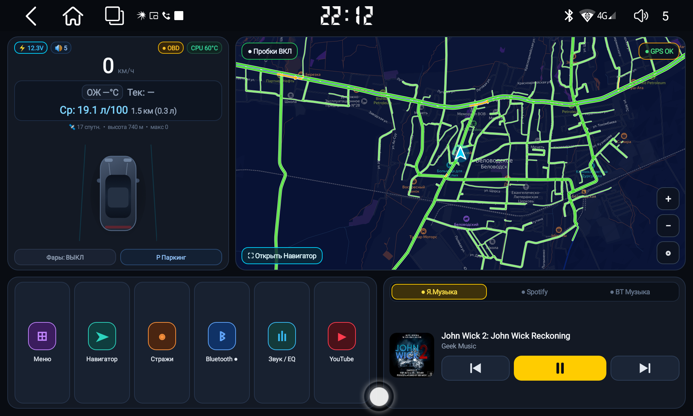

<div align="center">

# 🚗 KC97 Cockpit Launcher

**Ультралёгкий тёмный автомобильный лаунчер для Android-магнитол (KTE / KC97 / MT6797 / Android 8.0+)**  
*Нативная карта и живые пробки без WebView • Бортовой компьютер OBD-II для синего ELM327 v1.5 (`goc_spp`) • Авто-ночной режим по фарам • 3-вкладочный медиаплеер*

[](CHANGELOG.md)
[-34D399?style=for-the-badge)](#сборка-из-исходников-без-gradle-и-android-studio)
[](KC97-Cockpit-Launcher.apk)
[-8B5CF6?style=for-the-badge)](docs/ARCHITECTURE.md)
[](LICENSE)

**[🇬🇧 English](README.md)** | **🇷🇺 Русский**

<br/>



</div>

---

## Зачем нужен KC97 Cockpit?

На многих китайских Android-магнитолах (например, **KC97 / KTE / Helio X20 MT6797** на базе Android 8.0) штатные и сторонние лаунчеры перегружают процессор на 50–130%, съедают 500 МБ–1 ГБ оперативной памяти и перегревают устройство. Кроме того, из-за вырезанного системного стека Bluetooth (отдельный чип **SD-968**) обычные приложения не видят дешёвые синие Bluetooth-адаптеры **ELM327 v1.5**.

**KC97 Cockpit** решает все эти задачи в одном файле размером **~58 КБ** с **нулевыми внешними зависимостями** и **без единого WebView**:
- **~0% нагрузки на CPU** в простое и всего **~28–36 МБ ОЗУ**.
- Собственный Canvas-движок тёмной карты с живыми пробками и офлайн-кешем.
- Прямой драйвер **ELM327 v1.5** без root через `/dev/socket/goc_spp` + прозрачный **TCP-мост (`127.0.0.1:35000`)** для Car Scanner ELM OBD2.

---

## Возможности v2.5

### 0. Новое в v2.5 — Точный автоподъём OBD-II на SD-968, Вечное разрешение музыки и Плейлист (`☰ Плейлист`)
- **Железобетонное автоподключение OBD-II после перезапуска (`sdsdk968` 12-байтный протокол):**
  - Дизассемблирование `/ksys/bin/sdsdk968` (`sub_97c0` @ `0x0097e8`: `cmp r1, #0xc`) показало, что демон `/dev/socket/goc_spp` вызывает `bt_spp_connect()` **только если первый пакет равен ровно 12 байтам MAC** (`"001DA50821EB"` **без `\r\n`!**), а команда `AT#SP` в `/dev/goc_serial` вызывала Apple iAP и приводила к принудительному перезапуску `sdsdk968`!
  - Теперь `ObdBridgeManager` отправляет строго 12 байт MAC, сам подхватывает адрес `OBDII` и имя сопряжённого телефона из `/data/goc/bt_conf.ini` и никогда не сбрасывает Bluetooth телефона.
- **Неслетающее разрешение Яндекс Музыки и Spotify + Выбор треков из плейлиста (`☰ Плейлист`):**
  - Регистрация системной копии в `/kuser/app/KC97CarLauncher/KC97CarLauncher.apk` (`FLAG_SYSTEM` без затрагивания `/system` с dm-verity) + авто-выдача `enabled_notification_listeners` через `WRITE_SECURE_SETTINGS` + фоновый резервный парсер `su 0 dumpsys media_session` гарантируют работу треков после любой перезагрузки без ручной выдачи прав.
  - В карточке плеера добавлена кнопка **`☰ Плейлист (N)`** — показывает живую очередь треков Яндекс Музыки и Spotify с переключением на любую песню в 1 нажатие, строку `«Далее: …»` и сохранение последнего трека между поездками.

### 0b. Маршрут до точки Б, Камеры «Безопасного города», Боом офлайн и Логи поездок (v2.0+)
- **Выбор точки «Б» и маршрут прямо на главной карте (`🏁 Маршрут`):**
  - Поиск адреса, быстрые пресеты **🏠 Дом / 💼 Работа**, встроенные **офлайн-города Чуя и Иссык-Куля**, а также **долгое нажатие пальцем в любую точку на карте**.
  - Рисует неоновую линию маршрута + остаток `км` и времени прямо на нашей тёмной мини-карте + в один тап передаёт эту точку в **Яндекс Навигатор**.
  - **Автономность в Боомском ущелье:** активный маршрут сохраняется на флеш-памяти (`/sdcard/KC97MapCache/active_route.txt`) и не пропадает при потере 4G или перезапуске; даже при полном отсутствии интернета строится офлайн-маршрут по трассе Чуй → Боом → Иссык-Куль.
- **Камеры «Безопасного города» (`📷 Камеры` — офлайн + обновление с GitHub в 1 тап):**
  - Встроенная офлайн-база (`cameras/speedcam_kg.txt`, формат SpeedCamOnLine/Navitel), отображение значков камер на карте.
  - Предупреждение за **420 м с учётом направления движения** (встречные камеры игнорируются); порог оповещения по умолчанию **`+9 км/ч`** (на знаке `60` предупреждает с **`69 км/ч`**, до штрафа с 71).
  - При спокойной езде — аккуратная плашка; при превышении — **красная тревога + русский голос / сигнал с приглушением музыки**.
  - **Обновление базы с GitHub в 1 нажатие**, добавление новых камер кнопкой **«+ Камера здесь»** и поддержка своего файла `/sdcard/KC97MapCache/speedcam_custom.txt`.
- **Автономная докачка офлайн-карт (Чуй + Боом + Иссык-Куль) прямо с магнитолы:**
  - Кнопка в меню «Камеры и Карты» докачивает недостающие тайлы (включая детальное Боомское ущелье `z=14`) по Wi-Fi без подключения к ПК.
- **Фоновый «чёрный ящик» поездок (CSV) + Экспорт по кнопке:**
  - Незаметно пишет 1 строку в секунду в `/sdcard/KC97Logs/` (GPS, скорость, RPM, ОЖ, АКБ, расход, фары, ручник, CPU; старые логи старше 30 дней удаляются сами).
  - Кнопка **«📤 Экспорт логов поездки»** в меню OBD копирует файлы в `/sdcard/Download/KC97Logs/` и открывает системное меню «Поделиться» (Telegram / WhatsApp / почта / USB).

### 1. Карточка автомобиля и телеметрия OBD-II
- **Спидометр GPS + ЭБУ с защитой от дрейфа на стоянке:**
  - При подключённом OBD скорость сверяется с реальным датчиком скорости ЭБУ (`010D`) и оборотами (`010C`) — на светофорах и стоянке держится железный `0 км/ч` и `P Паркинг`.
  - При выключенном зажигании (`ACC`) работает гистерезис стоянки GPS (`6–10 км/ч` для выхода из нуля) — исключает ложные скачки `3–5 км/ч`.
- **Цветная индикация температуры антифриза (`ОЖ` / `0105`):**
  - 🔵 **Синий (`< 50°C`)** — мотор холодный, греемся / едем аккуратно.
  - 🟢 **Зелёный (`50–98°C`)** — рабочая температура, можно ехать.
  - 🟡 **Жёлтый (`99–106°C`)** — повышенная температура, держим под контролем.
  - 🔴 **Красный (`≥ 107°C`)** — перегрев!
- **Бортовой компьютер расхода топлива (Speed-Density — работает БЕЗ датчика MAF!):**
  - Откалиброван под **Honda Stream RN3 (K20A 2.0L i-VTEC, `VE = 0.78`)**, выбор объёма двигателя `1.5–3.5 л` доступен прямо с экрана.
  - Считает расход по `MAP (010B)` + `RPM (010C)` + `IAT (010F)` + `Speed (010D)` с отсечкой топлива при торможении двигателем (ПХХ).
  - Крупно показывает **текущий расход** (`л/ч` на месте, `л/100` в движении) и **накопительную статистику** (`Ср: л/100`, пробег `км` и сожжённые `л`), сохраняемую между поездками и перезапусками магнитолы.
- **Живой индикатор `● OBD`:** 🟢 зелёный — связь с ЭБУ установлена • 🟡 жёлтый — подключение / зажигание выключено • 🔴 красный — нет контакта с ELM327.
- **Аппаратные датчики машины и магнитолы:**
  - Напряжение АКБ (`⚡ V`) напрямую с ELM327 (`ATRV`) с подсветкой просадки (`< 11.8V`) и перезаряда (`> 14.8V`).
  - Сигнал фар (`Headlamp`) → живые лучи фар на машинке + **автоматический ночной режим** (приглушение яркости экрана и карты).
  - Реальный провод ручника из GPIO (`/sys/devices/virtual/kte/kte_hand_brake/hand_brake_status`) и задний ход (`backcar_satus`).
  - Температура процессора (`CPU °C`), текущая громкость (`🔊`), спутники GPS, высота над уровнем моря и максимальная скорость.

### 2. Нативная тёмная карта с живыми пробками и офлайн-кешем
- Собственный Canvas-рендерер в проекции **EPSG:3395** ([NativeMapView.java](src/com/kc97/carlauncher/NativeMapView.java)) — **0 WebView**, мгновенный запуск.
- Включение/выключение живых пробок Яндекс.Карт в одно касание.
- Персистентный офлайн-кеш на `/sdcard/KC97MapCache` с подстановкой родительских тайлов при пропадании 4G за городом.
- В комплекте скрипт [fetch_offline_maps.py](fetch_offline_maps.py) для предзагрузки офлайн-тайлов нужного региона.

### 3. 3-вкладочный медиа-виджет и панель быстрого запуска
- **3 вкладки плеера:** `Я.Музыка` (по умолчанию) • `Spotify` • `BT Музыка` (поддержка протоколов `KteBluetooth` для музыки с телефона).
- Чёткие векторные кнопки `Prev / Play-Pause / Next` ([MediaIconButton.java](src/com/kc97/carlauncher/MediaIconButton.java)) + обложка трека через `NotificationListenerService`.
- **6 горячих кнопок:** `Меню` (быстрый тёмный список приложений) • `Навигатор` (Яндекс Навигатор / Google Maps) • `Стражи` (видеорегистратор `com.fvision.camera`, долгое нажатие — Радио) • `Bluetooth ●` • `Звук / EQ` • `YouTube` (долгое нажатие — ZLink).

### 4. Встроенный мост ELM327 без Root (`goc_spp` → `127.0.0.1:35000`)
- Подключается напрямую к демону `/dev/socket/goc_spp` на магнитолах с чипом SD-968 без системного Bluetooth Android.
- Поднимает локальный **TCP-мост `127.0.0.1:35000`**: подключите **Car Scanner ELM OBD2** в режиме *Wi-Fi (`127.0.0.1`, порт `35000`)* — лаунчер сам уступит канал сканеру на время диагностики и автоматически вернётся к подсчёту расхода после выхода.

---

## Быстрая установка (готовый APK)

1. Скачайте готовый [KC97-Cockpit-Launcher.apk](KC97-Cockpit-Launcher.apk) (**v1.9**, ~58 КБ) и установите через флешку или по ADB:
   ```powershell
   .\install.ps1 -DeviceIp 192.168.0.168
   ```
2. Выдайте разрешения на геолокацию, память и включите **Доступ к уведомлениям** для **KC97 Media Bridge** (Настройки → Приложения и уведомления → Спец. доступ → Доступ к уведомлениям) для отображения треков Я.Музыки и Spotify.
   - *На Android 8.0 после обновления по ADB можно быстро переподключить сервис командой:*
     ```sh
     su 0 pm disable com.kc97.carlauncher/.CarMediaListenerService && su 0 pm enable com.kc97.carlauncher/.CarMediaListenerService
     ```
3. Выберите **KC97 Cockpit** основным экраном «Домой» (`cmd package set-home-activity com.kc97.carlauncher/.MainActivity`).

---

## Настройка под свой автомобиль и ELM327

- **Объём двигателя и сброс расхода:** тапните по блоку расхода или по значку `● OBD` (объём `1.5–3.5 л`, принудительное переподключение OBD, запуск Car Scanner, сброс статистики).
- **MAC-адрес вашего ELM327:** укажите 12-символьный MAC без двоеточий в константе `DEFAULT_OBD_MAC` в [ObdBridgeManager.java](src/com/kc97/carlauncher/ObdBridgeManager.java) перед сборкой (либо в `SharedPreferences` `kc97_cockpit` → ключ `obd_mac`).
- **Офлайн-карты своего региона:** отредактируйте координаты `collect_bbox(...)` в [fetch_offline_maps.py](fetch_offline_maps.py), запустите `python fetch_offline_maps.py` и залейте на магнитолу:
  ```powershell
  .\install.ps1 -DeviceIp 192.168.0.168 -PushOfflineMaps
  ```

---

## Сборка из исходников (без Gradle и Android Studio)

Собирается за **~3 секунды** стандартными инструментами Android SDK (`aapt2`, `javac`, `d8`, `zipalign`, `apksigner`):

- **JDK 11 / 17+** (`JAVA_HOME` или в `PATH`)
- **Android SDK** (`platforms/android-34` + `build-tools/34.0.0`)
- Windows PowerShell 5.1+

```powershell
.\build.ps1
```
При первой сборке скрипт сам создаст локальный `debug.keystore` (игнорируется Git) и соберёт подписанный `KC97-Cockpit-Launcher.apk`.

---

## Документация и структура

- 📘 **Подробная техническая документация:** [Русский (`docs/ARCHITECTURE.md`)](docs/ARCHITECTURE.md) | [English (`docs/ARCHITECTURE.en.md`)](docs/ARCHITECTURE.en.md)
- 📋 **История версий:** [CHANGELOG.md](CHANGELOG.md)

## Лицензия

Распространяется под лицензией [MIT](LICENSE) — свободно используйте, дорабатывайте и делитесь с другими владельцами Android-магнитол.
